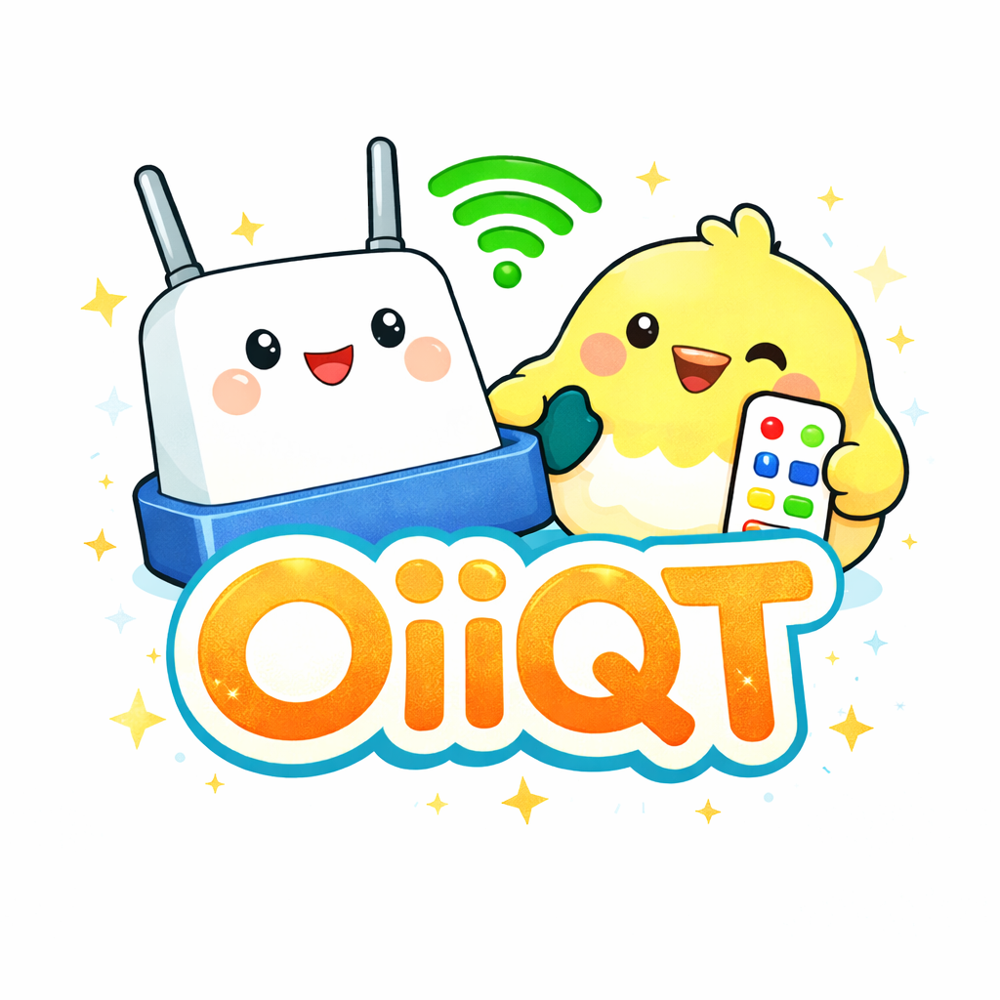
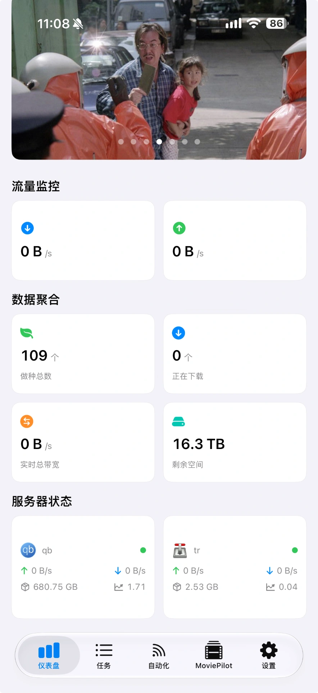
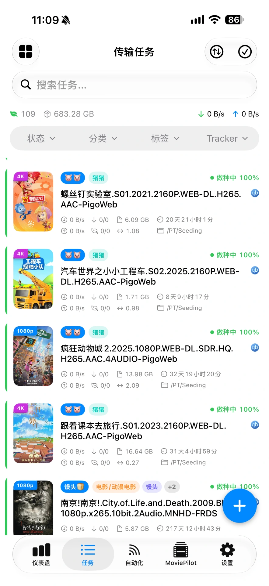
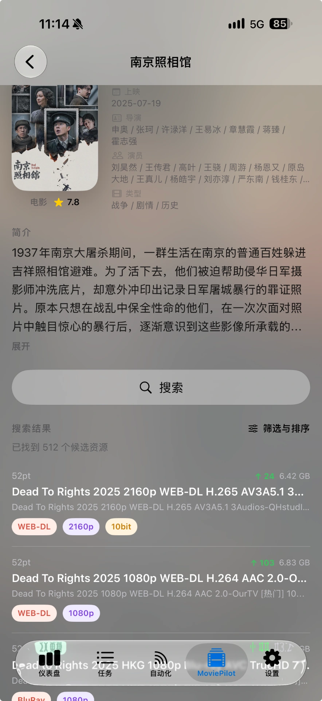

<p align="center">
  
</p>

<h1 align="center">OiiQT</h1>

<p align="center">
  <strong>English</strong> | <a href="README.zh-CN.md">简体中文</a>
</p>

Manage your **qBittorrent, Transmission, and MoviePilot** services from your iPhone or iPad.

Built with SwiftUI, OiiQT brings server management, torrent tasks, traffic dashboards, RSS automation, and media posters into one app. Your servers handle downloads; OiiQT lets you monitor and manage them.

**No memberships, no in-app purchases, and no server-count limit.** Optional features are available in Settings.

[📦 Download](https://github.com/gangz1o/OiiQT/releases/latest) · [🤖 Builds](https://github.com/gangz1o/OiiQT/actions/workflows/release-ipa.yml) · [🐛 Issues](https://github.com/gangz1o/OiiQT/issues) · [📄 GPLv3](LICENSE)

## 📸 Screenshots

**Download management**

<table>
  <tr>
    <th>Dashboard</th>
    <th>Torrent tasks</th>
  </tr>
  <tr>
    <td align="center"><a href="docs/screenshots/dashboard.webp"></a></td>
    <td align="center"><a href="docs/screenshots/tasks.webp"></a></td>
  </tr>
</table>

**MoviePilot**

<table>
  <tr>
    <th>Discover</th>
    <th>Media search</th>
    <th>Media details & resource results</th>
  </tr>
  <tr>
    <td align="center"><a href="docs/screenshots/moviepilot-discover.webp"></a></td>
    <td align="center"><a href="docs/screenshots/moviepilot-search.webp"></a></td>
    <td align="center"><a href="docs/screenshots/moviepilot-details.webp"></a></td>
  </tr>
</table>

## ✨ Features

| Area | What you can do |
| --- | --- |
| Multiple servers | Connect qBittorrent and Transmission; switch servers or view tasks together |
| Torrent management | Add torrents, search and filter, perform batch actions, inspect files, configure download paths and speed limits |
| Dashboard | Monitor traffic, transfer totals, server status, storage, and recently completed tasks |
| RSS automation | Manage feeds and download rules, match items, and send downloads to your servers |
| Media information | Match Douban and TMDB posters and metadata; use your own TMDB API key |
| MoviePilot | Connect instances, browse and search media, view details, and submit downloads |
| Personalization | Configure dashboard modules and poster backgrounds, tracker aliases, hidden node names, and light/dark appearance |
| Configuration sync | Optional iCloud configuration sync |
| Languages | English and Simplified Chinese |

Available actions vary by downloader type.

## 📦 Download & Install

Requires **iOS / iPadOS 18.0 or later**.

### Option 1: Sign and install an IPA

Download `OiiQT-unsigned.ipa` from **Assets** on the [latest release](https://github.com/gangz1o/OiiQT/releases/latest). For a manual build, open a successful [workflow run](https://github.com/gangz1o/OiiQT/actions/workflows/release-ipa.yml), download the **OiiQT-unsigned** artifact while signed in to GitHub, and extract the ZIP to get the IPA. Choose one of the signing methods below.

#### Sideloadly (Mac or Windows)

1. Install [Sideloadly](https://sideloadly.io/) on your computer, following its setup instructions.
2. Connect and unlock your iPhone/iPad, trust the computer, then select the device and drag the IPA into Sideloadly.
3. Use your own Apple Account in Apple ID sideload mode, click **Start**, and complete the authentication prompts.
4. If prompted, trust the developer under **Settings → General → VPN & Device Management**. Enable **Settings → Privacy & Security → Developer Mode**, follow the restart prompts, and open OiiQT.

#### SideStore or AltStore Classic

1. Follow the [SideStore setup guide](https://docs.sidestore.io/docs/installation/install.html) or the AltStore Classic guide for [macOS](https://faq.altstore.io/altstore-classic/how-to-install-altstore-macos) or [Windows](https://faq.altstore.io/altstore-classic/how-to-install-altstore-windows). Sign in with your Apple Account during setup.
2. Save `OiiQT-unsigned.ipa` to **Files** on your iPhone or iPad. In SideStore or AltStore Classic, open **My Apps**, tap **+**, and select the IPA to sign and install it.
3. For SideStore, connect to Wi-Fi and turn on LocalDevVPN when installing or refreshing. For AltStore Classic, keep [AltServer](https://faq.altstore.io/altstore-classic/altserver) running on a computer on the same Wi-Fi network, or connect the device to that computer by USB.

Free-account signing normally expires after **7 days**; refresh the app before expiry or sign it again. See the [Sideloadly FAQ](https://sideloadly.io/faq) for current limits and troubleshooting. For updates, use the same account and Bundle Identifier and install over the existing app to retain its data; changing the signing team may require entering saved credentials again.

The release IPA is unsigned and contains no distribution certificate or provisioning profile. It must be signed before installation. Capabilities such as iCloud depend on the account, profile, and entitlements used when signing.

The repository does not preset a developer Team ID. Your signing tool supplies your own signing identity; the author's developer account is not required.

Reference: [GestaltX](https://github.com/huamidev/GestaltX) also documents IPA distribution and re-signing. It is a separate iOS project and is not required to install OiiQT.

### Option 2: Build and install with Xcode

Follow [Install from source on an iPhone or iPad](#install-from-source-on-an-iphone-or-ipad) below. This requires a Mac and Xcode.

## 🚀 Getting Started

### Connect a downloader

Go to **Settings → Server Settings**, add a server, select qBittorrent or Transmission, and enter its address, port, and credentials.

- Enable the downloader's Web UI / RPC and ensure your device can reach it.
- Match HTTPS and the API path to your deployment, including any reverse proxy.
- OiiQT does not provide or host a download server.

### qBittorrent 5.2 authentication

In the server editor, choose **Username and Password** or **API Key (qBittorrent 5.2+)** under **Authentication Method**. Generate an API key in qBittorrent's **Options → Web UI → API Key**, then paste it into the API Key field; no username is needed in this mode. Keys use Bearer authentication, not the password login endpoint. See the [official API key guide](https://github.com/qbittorrent/wiki/blob/master/API-Key-Authentication-%28%E2%89%A5v5.2.0%29.md).

OiiQT accepts legacy `200 / Ok.` logins and newer `204` responses, uses the session cookie returned by the server, and accepts successful `202/204` action responses. Existing servers keep password authentication by default. Passwords and API keys are stored in the device Keychain; configuration sync includes the authentication mode, not the secret.

For reverse proxies, keep the default API path `/api/v2`, or include your published subpath, such as `/qb/api/v2`. If an upgrade produces HTTP 401, check credentials and Host/Origin forwarding: qBittorrent 5.2.2 changed how `X-Forwarded-Host` is used when reverse proxy support is disabled. HTTP 403 can indicate an invalid session/key or a temporary IP ban. See the [official changelog](https://www.qbittorrent.org/news); changing the app cannot repair an incorrect proxy configuration.

### Enable optional features

Open **Settings → Extensions** to enable TMDB posters, global task aggregation, dashboard backgrounds, hidden node names, or iCloud sync. You can also configure tracker aliases and a custom TMDB API key. The current version retains a built-in service configuration; your own key takes priority when provided.

### Connect MoviePilot

Add an instance and its access token in **Settings → Extensions → MoviePilot Settings**. The MoviePilot tab appears once an instance is configured.

MoviePilot V2 and V3 use the `/api/v1` prefix; do not change it to `/api/v3`. Enter the instance URL (including a reverse proxy subpath if applicable) and an API Key or a login access token. Fresh V3 installations must complete initialization in the Web UI first.

The client accepts both V2 responses and V3's `success / message / data` envelope. Media detail and resource search also support V3's separate `media_source` and native `media_id`. The compatibility checks use the official [OpenAPI documentation](https://api.movie-pilot.org/) (V3.1.9 at the time of this update).

### Set up RSS

Add RSS feeds and download rules in the **Automation** tab. Configure the refresh interval in Settings. Automatic refresh runs while the app is in the foreground and stops in the background; it is not a continuous server-side scheduler.

## 🛠️ Local Development

### Requirements

- macOS and Xcode; the current release workflow uses **Xcode 26.6**.
- An existing simulator or device running iOS 18.0 or later.
- Dependencies resolve through Swift Package Manager; Nuke is locked to 13.0.1.

### Open the project

```bash
git clone https://github.com/gangz1o/OiiQT.git
cd OiiQT
open OiiQT.xcodeproj
```

Wait for Swift Package Manager to finish resolving dependencies.

### Install from source on an iPhone or iPad

1. Add your Apple Account in **Xcode → Settings → Accounts**.
2. Connect and unlock your device, trust the Mac, and enable **Settings → Privacy & Security → Developer Mode** on the device when prompted.
3. Select the project, then **TARGETS → OiiQT → Signing & Capabilities**. Enable **Automatically manage signing** and select your own **Team**.
4. Set a unique **Bundle Identifier**, for example `com.yourname.oiiqt`. Keep this identifier and team consistent for later updates.
5. If signing reports that your team does not support iCloud or Push Notifications, remove those capabilities in your local copy. Check `OiiQT/OiiQT.entitlements` and remove the corresponding `com.apple.developer.ubiquity-kvstore-identifier` and `aps-environment` entries if they remain. Leave iCloud sync disabled in the app when building without iCloud. Teams that support these capabilities can retain them with a matching provisioning profile.
6. Select the **OiiQT** scheme and your connected device as the run destination, then press **⌘R**. Allow Xcode to register the device if prompted; it will build, sign, install, and launch the app.

See Apple's [Run an app on a device](https://help.apple.com/xcode/mac/current/en.lproj/dev5a825a1ca.html) and [Signing & Capabilities workflow](https://help.apple.com/xcode/mac/current/en.lproj/dev60b6fbbc7.html) for signing setup. Keep your account credentials, certificates, and provisioning profiles out of Git.

### Build for an existing simulator

List the available devices:

```bash
xcrun simctl list devices available
```

Replace `<UDID>` below with an existing compatible simulator's identifier:

```bash
xcodebuild \
  -project OiiQT.xcodeproj \
  -scheme OiiQT \
  -configuration Debug \
  -destination 'platform=iOS Simulator,id=<UDID>' \
  -derivedDataPath build/DerivedData \
  build
```

Keep default code signing enabled for simulator builds. Disabling it can remove Keychain access and prevent passwords from being saved even when a connection test succeeds. The unsigned release IPA must be signed by the installer before use.

### qBittorrent compatibility checks

Run `python3 tests/run-qbittorrent-compatibility.py` on a Mac with Xcode and Python 3. It compiles the production authentication helper and tests it against a temporary local HTTP server, including legacy/new login responses, cookie persistence, Bearer authentication, special-character passwords, and failure responses. These contract checks do not replace testing against your own qBittorrent instance and reverse proxy.

### MoviePilot compatibility checks

Run `python3 tests/run-moviepilot-compatibility.py` to exercise the production connection, discovery, detail, resource search, and download clients against local V2/V3 HTTP fixtures. The checks include API Key/access-token authentication, wrapped responses, media identities, and error handling. Real deployments and reverse proxies still need instance-specific verification.

## 🤖 Automated IPA Releases

The workflow lives in [`.github/workflows/release-ipa.yml`](.github/workflows/release-ipa.yml).

1. Push your code and the workflow to GitHub.
2. Create a tag pointing to a commit containing the workflow, such as `v1.0.1`.
3. Publish a GitHub Release or prerelease for that tag.
4. Actions archives the iOS app, packages an unsigned IPA, and attaches `OiiQT-unsigned.ipa` to the release.

No Apple certificates or additional secrets are needed for the build. Uploads use the workflow's `GITHUB_TOKEN`. The app version and build number come from the Xcode project settings; the tag does not update them automatically.

You can also run **Actions → Build unsigned IPA → Run workflow**. Manual runs produce an Actions artifact only; they do not create a release or attach files to an existing one.

This workflow adds assets after publication, so published releases must allow updates. If you enable immutable releases, adapt it to upload assets to a draft before publishing.

## 🗂️ Project Structure

```text
OiiQT/
├── models/       Data models, app state, and downloader clients
├── services/     Media, MoviePilot, credentials, and sync services
├── viewmodels/   View state and presentation logic
├── views/        SwiftUI screens and components
├── utils/        Parsing, networking, and other helpers
└── Assets.xcassets/
OiiQT.xcodeproj/
.github/workflows/release-ipa.yml
```

## 🤝 Contributing

Bug reports, feature suggestions, and pull requests are welcome. Use [Issues](https://github.com/gangz1o/OiiQT/issues) and include your app version, OS version, downloader type/version, and steps to reproduce.

Remove passwords, access tokens, RSS passkeys, and private server details from logs and screenshots before sharing them.

## 💬 Community

Have questions, ideas, or just want to chat with a community of developers?

- **Forum**: [linux.do](https://linux.do/) — Join the discussion, share your setup, report issues, and stick around.
- **Issues**: [GitHub Issues](https://github.com/gangz1o/OiiQT/issues) — Report reproducible bugs and suggest features.

## ⭐ Star History

<a href="https://www.star-history.com/?repos=gangz1o%2FOiiQT&amp;type=date&amp;legend=top-left">
  <picture>
    <source media="(prefers-color-scheme: dark)" srcset="https://api.star-history.com/chart?repos=gangz1o/OiiQT&amp;type=date&amp;theme=dark&amp;legend=top-left" />
    <source media="(prefers-color-scheme: light)" srcset="https://api.star-history.com/chart?repos=gangz1o/OiiQT&amp;type=date&amp;legend=top-left" />
    
  </picture>
</a>

## 📄 License

OiiQT is licensed under the **GNU General Public License v3.0 (GPL-3.0)**. See [LICENSE](LICENSE) for the full terms. Third-party dependencies retain their respective licenses.
