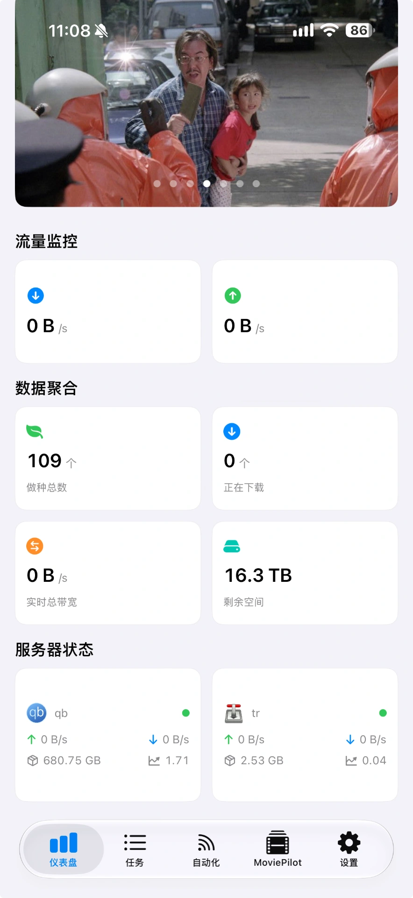
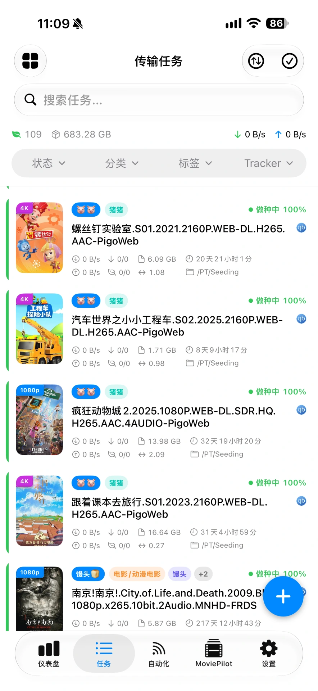
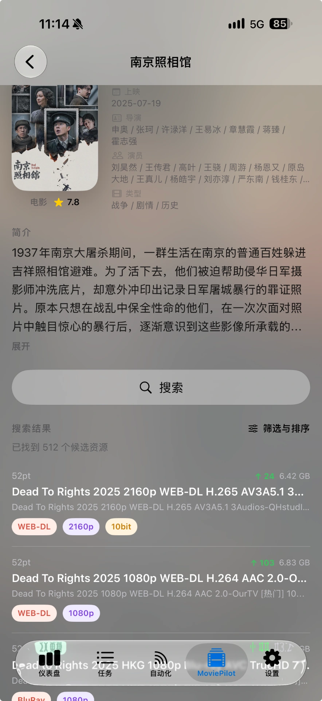

<p align="center">
  
</p>

<h1 align="center">OiiQT 🌊</h1>

<p align="center">
  <a href="README.md">English</a> | <strong>简体中文</strong>
</p>

用 iPhone 和 iPad 管理你的 qBittorrent、Transmission 和 MoviePilot。

OiiQT 使用 SwiftUI 构建，将多服务器任务管理、流量仪表盘、RSS 自动化和影视海报展示集中在一个客户端中。下载任务由你自己的服务器执行，手机用于查看和管理。

**无会员、无内购，不限制添加服务器的数量。** 扩展功能可在设置中自行开启。

[下载最新版本](https://github.com/gangz1o/OiiQT/releases/latest) · [构建记录](https://github.com/gangz1o/OiiQT/actions/workflows/release-ipa.yml) · [反馈问题](https://github.com/gangz1o/OiiQT/issues)

## 📸 界面预览

**下载管理**

<table>
  <tr>
    <th>仪表盘</th>
    <th>下载任务</th>
  </tr>
  <tr>
    <td align="center"><a href="docs/screenshots/dashboard.webp"></a></td>
    <td align="center"><a href="docs/screenshots/tasks.webp"></a></td>
  </tr>
</table>

**MoviePilot**

<table>
  <tr>
    <th>影视发现</th>
    <th>媒体搜索</th>
    <th>媒体详情与资源结果</th>
  </tr>
  <tr>
    <td align="center"><a href="docs/screenshots/moviepilot-discover.webp"></a></td>
    <td align="center"><a href="docs/screenshots/moviepilot-search.webp"></a></td>
    <td align="center"><a href="docs/screenshots/moviepilot-details.webp"></a></td>
  </tr>
</table>

## ✨ 功能

| 模块 | 能力 |
| --- | --- |
| 多服务器管理 | 连接 qBittorrent、Transmission，切换服务器或聚合查看任务 |
| 下载任务 | 添加任务、搜索筛选、批量操作、查看文件、设置下载路径和限速 |
| 仪表盘 | 查看实时流量、上传下载统计、服务器状态、存储情况和近期完成任务 |
| RSS 自动化 | 管理订阅源、设置下载规则、匹配筛选条件并提交任务 |
| 影视信息 | 豆瓣与 TMDB 海报匹配、影视元数据、自定义 TMDB API Key |
| MoviePilot | 配置服务实例、浏览和搜索媒体、查看详情并提交下载 |
| 个性化 | 仪表盘模块配置、海报背景、Tracker 别名、隐藏节点名称、深浅色外观 |
| 配置同步 | 可选的 iCloud 配置同步 |
| 语言 | 简体中文、英文 |

不同下载器支持的操作有所差异，界面会根据服务器类型提供对应功能。

## 📦 下载与安装

需要 **iOS / iPadOS 18.0 或更高版本**。

### 方式一：自签 IPA 安装

1. 打开 [Releases](https://github.com/gangz1o/OiiQT/releases)，在 **Assets** 中下载 `OiiQT-unsigned.ipa`。如果需要手动构建的版本，请登录 GitHub，打开成功的 [工作流运行记录](https://github.com/gangz1o/OiiQT/actions/workflows/release-ipa.yml)，下载 **OiiQT-unsigned** Artifact，解压 ZIP 后得到 IPA。
2. 在 Mac 或 Windows 电脑上安装 [Sideloadly](https://sideloadly.io/)，按官网说明完成环境配置。
3. 连接并解锁 iPhone / iPad，信任电脑，在 Sideloadly 中选择设备并拖入 IPA。
4. 使用 Apple ID 自签模式，填写自己的 Apple 账号，点击 **Start**，按提示完成账号验证。
5. 如有提示，在「设置 → 通用 → VPN 与设备管理」中信任开发者；开启「设置 → 隐私与安全性 → 开发者模式」，按提示重启并确认后打开 OiiQT。

免费账号签名通常 **7 天**到期，请在到期前刷新签名，或重新签名安装。最新限制及故障处理见 [Sideloadly FAQ](https://sideloadly.io/faq)。更新时使用相同账号和 Bundle Identifier，覆盖安装以保留应用数据；更换签名团队后可能需要重新输入已保存的凭据。

发布附件是未签名 IPA，不包含分发证书或描述文件，不能直接安装。iCloud 等系统能力取决于重新签名时使用的账号、描述文件与权限配置。

仓库没有预设开发者 Team ID，签名工具会使用你自己的签名身份，无需作者的开发者账号。

### 方式二：通过 Xcode 从源码安装

按下方「[从源码安装到 iPhone 或 iPad](#从源码安装到-iphone-或-ipad)」操作，需要 Mac 和 Xcode。

## 🚀 开始使用

### 连接下载器

在「设置 → 服务器设置」添加服务器，选择 qBittorrent 或 Transmission，填写地址、端口和认证信息。

- 先开启下载器的 Web UI / RPC，并确保设备能够访问该地址。
- 使用反向代理时，按实际部署填写 HTTPS 和访问路径。
- 应用不会提供或托管下载服务器。

### 开启扩展功能

在「设置 → 扩展功能」中开启 TMDB 海报数据、全局任务聚合、仪表盘背景、隐藏节点名称或 iCloud 同步，也可以配置 Tracker 别名。

TMDB API Key 可在同一页面配置。当前版本保留内置服务配置，填写自己的 Key 后会优先使用自定义配置。

### 连接 MoviePilot

在「设置 → 扩展功能 → MoviePilot 设置」中添加实例并配置访问令牌。配置完成后，底部会显示 MoviePilot 页面。

### 使用 RSS

在「自动化」页面添加 RSS 源并配置下载规则；刷新间隔可在设置中调整。当前自动刷新在应用前台运行，切到后台后停止，不应将手机端作为全天候后台调度服务。

## 🛠️ 本地开发

### 环境

- macOS 与 Xcode；当前 CI 使用 **Xcode 26.6**。
- iOS 18.0 以上的模拟器或真机。
- Swift Package Manager 自动解析依赖，已锁定 Nuke 13.0.1。

### 打开项目

```bash
git clone https://github.com/gangz1o/OiiQT.git
cd OiiQT
open OiiQT.xcodeproj
```

等待 Swift Package Manager 完成依赖解析。

### 从源码安装到 iPhone 或 iPad

1. 在 **Xcode → Settings → Accounts** 中添加自己的 Apple 账号。
2. 连接并解锁设备，信任 Mac，按提示在设备的「设置 → 隐私与安全性 → 开发者模式」中开启开发者模式。
3. 选中项目，进入 **TARGETS → OiiQT → Signing & Capabilities**，勾选 **Automatically manage signing**，在 **Team** 中选择自己的团队。
4. 设置唯一的 **Bundle Identifier**，例如 `com.yourname.oiiqt`。后续更新请保持标识和签名团队一致。
5. 如果签名报错提示团队不支持 iCloud 或 Push Notifications，请在本地副本中移除相应能力。检查 `OiiQT/OiiQT.entitlements`，若仍有对应的 `com.apple.developer.ubiquity-kvstore-identifier` 和 `aps-environment` 条目，也一并移除。不带 iCloud 能力构建时，请保持应用内 iCloud 同步关闭；支持这些能力的团队可使用匹配的描述文件保留它们。
6. 选择 **OiiQT** Scheme 和已连接的真机，按 **⌘R**。如有提示，允许 Xcode 注册设备，随后会自动构建、签名、安装并启动应用。

签名配置可参考 Apple 的 [Run an app on a device](https://help.apple.com/xcode/mac/current/en.lproj/dev5a825a1ca.html) 和 [Signing & Capabilities workflow](https://help.apple.com/xcode/mac/current/en.lproj/dev60b6fbbc7.html)。账号凭据、证书与描述文件不要提交到 Git。

### 命令行构建模拟器版本

先查看已有模拟器：

```bash
xcrun simctl list devices available
```

将下面的 `<UDID>` 替换为一个已有、兼容的模拟器 UDID：

```bash
xcodebuild \
  -project OiiQT.xcodeproj \
  -scheme OiiQT \
  -configuration Debug \
  -destination 'platform=iOS Simulator,id=<UDID>' \
  -derivedDataPath build/DerivedData \
  build
```

模拟器构建也请保留默认签名；禁用签名会导致钥匙串权限缺失，出现测试连接成功但无法保存密码的问题。Release 工作流中的未签名 IPA 需由安装者重新签名后使用。

## 🤖 自动发布 IPA

工作流位于 [`.github/workflows/release-ipa.yml`](.github/workflows/release-ipa.yml)。

1. 将版本代码与工作流推送到 GitHub。
2. 基于包含工作流的提交创建标签，例如 `v1.0.1`。
3. 在 GitHub 发布正式 Release 或预发布 Release。
4. Actions 构建真机 Release 归档、打包未签名 IPA，并将 `OiiQT-unsigned.ipa` 上传到该 Release。

构建无需配置 Apple 证书或额外 Secrets，上传使用工作流自带的 `GITHUB_TOKEN`。应用版本号和构建号取自 Xcode 项目设置；发布前按需更新，标签不会自动修改这两个值。

也可以在 **Actions → Build unsigned IPA → Run workflow** 中手动构建。手动运行只生成 Actions Artifact，不创建 Release，也不向已有 Release 上传附件。

当前流程在 Release 发布后追加附件，因此需要允许修改已发布的 Release；若启用不可变 Release，应调整为先构建并上传到草稿，再发布。

## 🗂️ 项目结构

```text
OiiQT/
├── models/       数据模型、应用状态与下载器客户端
├── services/     影视数据、MoviePilot、凭据与同步服务
├── viewmodels/   页面状态与展示逻辑
├── views/        SwiftUI 页面和组件
├── utils/        解析与网络等辅助代码
└── Assets.xcassets/
OiiQT.xcodeproj/
.github/workflows/release-ipa.yml
```

## 🤝 反馈与贡献

欢迎通过 [Issues](https://github.com/gangz1o/OiiQT/issues) 提交问题或功能建议，也欢迎提交 Pull Request。

报告问题时请附上应用版本、系统版本、下载器类型与版本、复现步骤和相关截图。分享日志前请移除密码、访问令牌、RSS Passkey 等个人凭据。

## 💬 Community · 社区

有问题、想法，或想与其他开发者交流？

- **论坛**：[linux.do](https://linux.do/) — 参与讨论、分享你的配置与使用体验，交流问题和建议。
- **问题反馈**：[GitHub Issues](https://github.com/gangz1o/OiiQT/issues) — 提交可复现的问题与功能建议。

## ⭐ Star History

<a href="https://www.star-history.com/?repos=gangz1o%2FOiiQT&amp;type=date&amp;legend=top-left">
  <picture>
    <source media="(prefers-color-scheme: dark)" srcset="https://api.star-history.com/chart?repos=gangz1o/OiiQT&amp;type=date&amp;theme=dark&amp;legend=top-left" />
    <source media="(prefers-color-scheme: light)" srcset="https://api.star-history.com/chart?repos=gangz1o/OiiQT&amp;type=date&amp;legend=top-left" />
    
  </picture>
</a>

## 📄 许可证

OiiQT 采用 **GNU General Public License v3.0（GPL-3.0）**。完整条款见 [LICENSE](LICENSE)。第三方依赖遵循各自的许可证。
